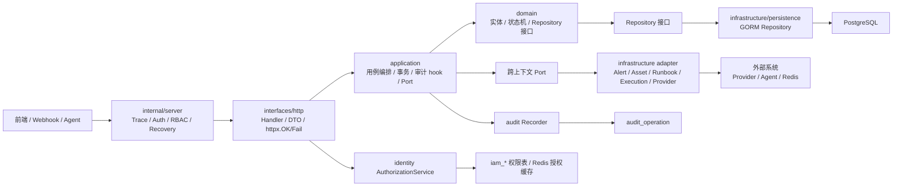
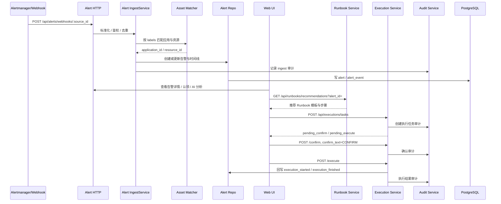
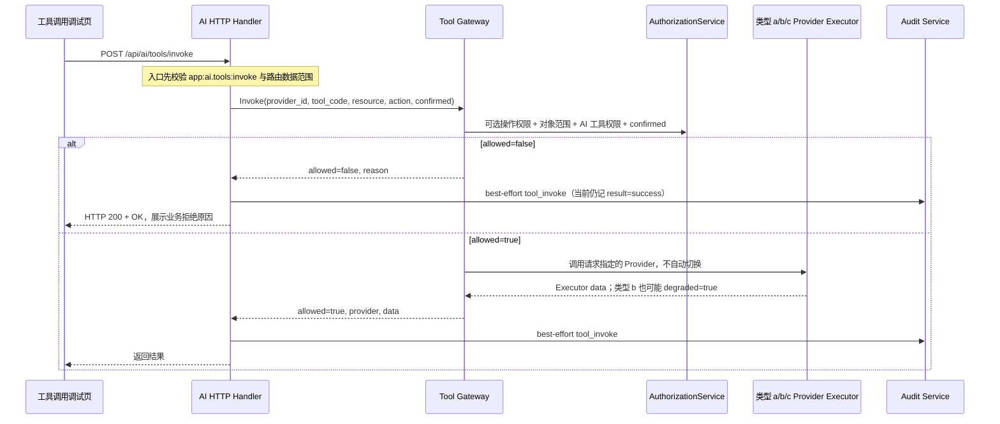
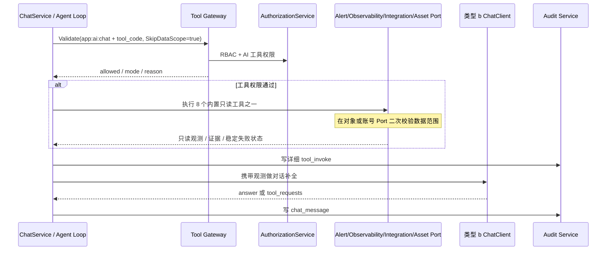
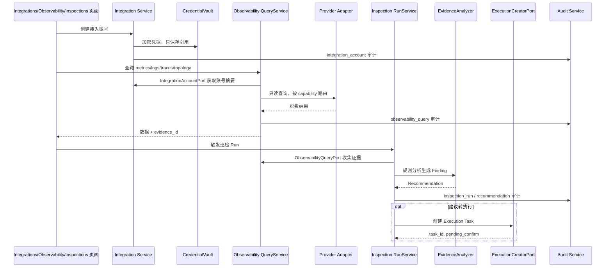
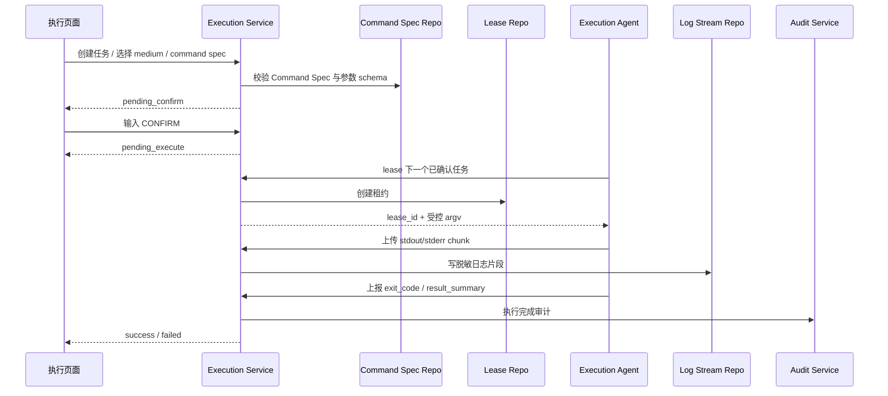
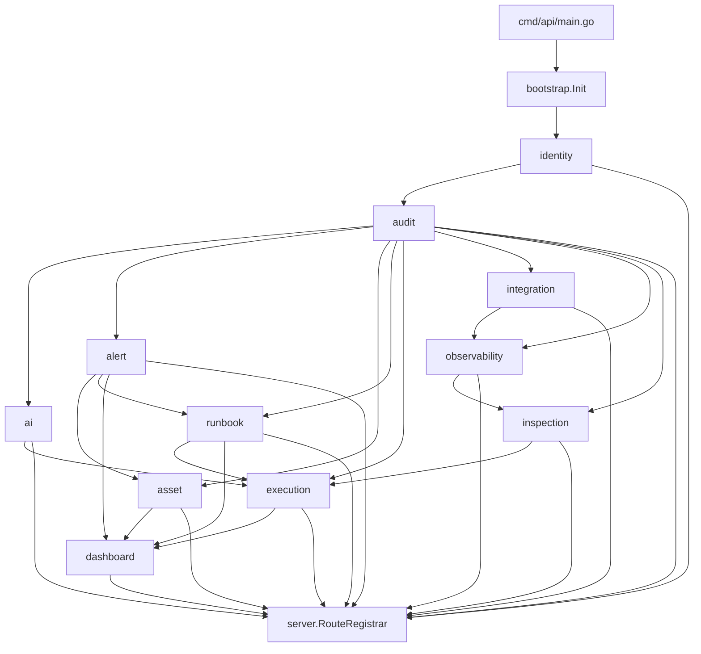

# AI 运维平台调用关系图

本文档用 Mermaid 图补充说明平台当前已落地的主要调用关系。更完整的边界说明见 `docs/AI运维平台整体流程与调用关系.md`。

## 1. 后端运行时调用总图



## 2. P0 告警到执行闭环



## 3. AI Provider、工具调用与执行边界

### 3.1 直接工具调试：授权后转发给指定 Provider



Gateway 自身不创建 Execution Task。`execution.tasks.propose` 没有平台内置工具实现，直接调用只能转发给外部 Provider；这不能替代 Execution 状态机。

### 3.2 对话内置只读工具：本地执行，模型单独调用



告警分析是另一条路径：AnalyzeService 读取告警和证据后，通过 `Gateway.Invoke` 把 `alarm.analyze` 交给动态选择的 Provider。对话中的同名工具只是在本地读取告警快照，不能混为同一外部调用。

AI 回答中的“生成执行计划”由前端调用既有 Execution Task 创建接口；任务仍须经过 Execution 权限、风险、确认和审计，不能由上述工具图推断 Gateway 会直接执行。

### 3.3 会话消息、幂等与 Loop 收敛

```mermaid
sequenceDiagram
    participant UI as AI 助手工作台
    participant Chat as ChatService
    participant Repo as SessionRepository
    participant Loop as Agent Loop
    participant Final as finalizeAnswer
    participant AU as Audit Service

    UI->>Chat: 同步或 SSE 发送 content + client_message_id
    Chat->>Repo: 校验会话归属并查幂等键
    alt 已有 assistant
        Repo-->>Chat: 首次回答
        Chat-->>UI: 原样重放，不重新取数/调模型
    else 只有 user，没有 assistant
        Chat-->>UI: 409 / SSE error(FAILED_PRECONDITION)
    else 新提问
        Chat->>Repo: 事务一：user + title/context/updated_at
        Chat->>Loop: gather + 类型 b 模型 + 最多 4 轮只读工具
        Loop-->>Chat: answer，或预算/无进展后强制收敛
        Chat->>Final: 过滤证据、生成 actions、校验执行提议权限
        Final-->>Chat: execution.propose action + 权限 tool_call（不建任务）
        Chat->>Repo: 事务二：assistant + updated_at
        Chat->>AU: chat_message / tool_invoke（best-effort）
        Chat-->>UI: answer（落库后的最终推送失败不回滚）
    end
```

用户和助手消息不是同一事务；取消检查点之前已保存的用户消息会保留。Loop 的强制收敛成功可以正常回答，只有仍失败才进入 agent_loop_exhausted。

## 4. 只读观测与巡检链路



## 5. Execution Agent 派发链路



## 6. 模块装配关系



## 7. 维护原则

- 图中实线表示当前代码或契约中已存在的调用方向；后续新增调用应优先补 application Port。
- AI、Inspection、Recommendation 只能创建待确认 Execution Task，不能直接派发或执行。
- Integration 负责凭据保存和账号能力；Observability 只拿脱敏账号摘要，不持有明文凭据。
- 前端 API 文档见 `web/src/api/README.md`，稳定运维契约见 `ops/*.md`。
